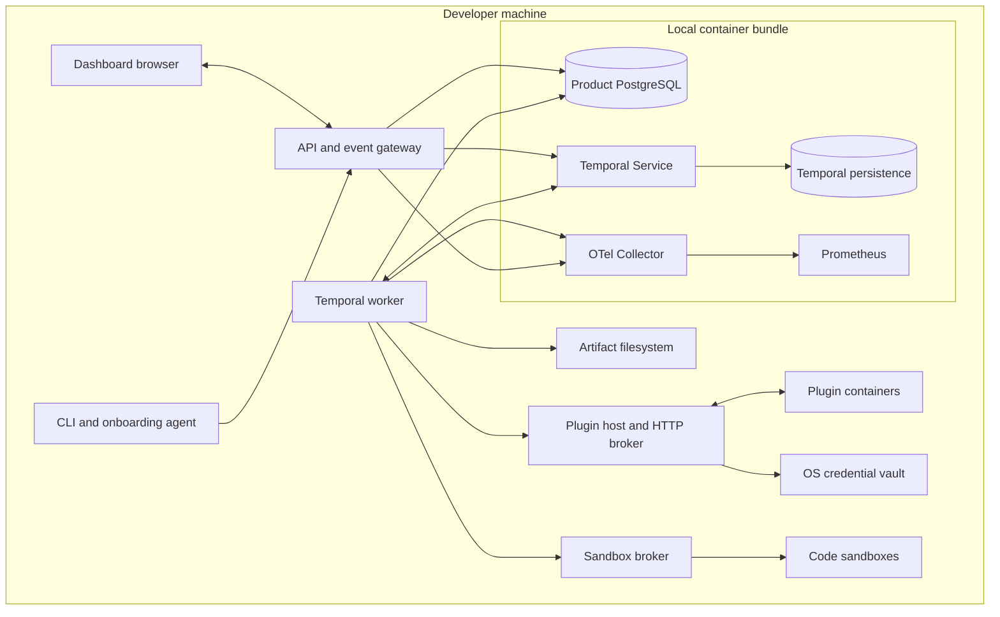
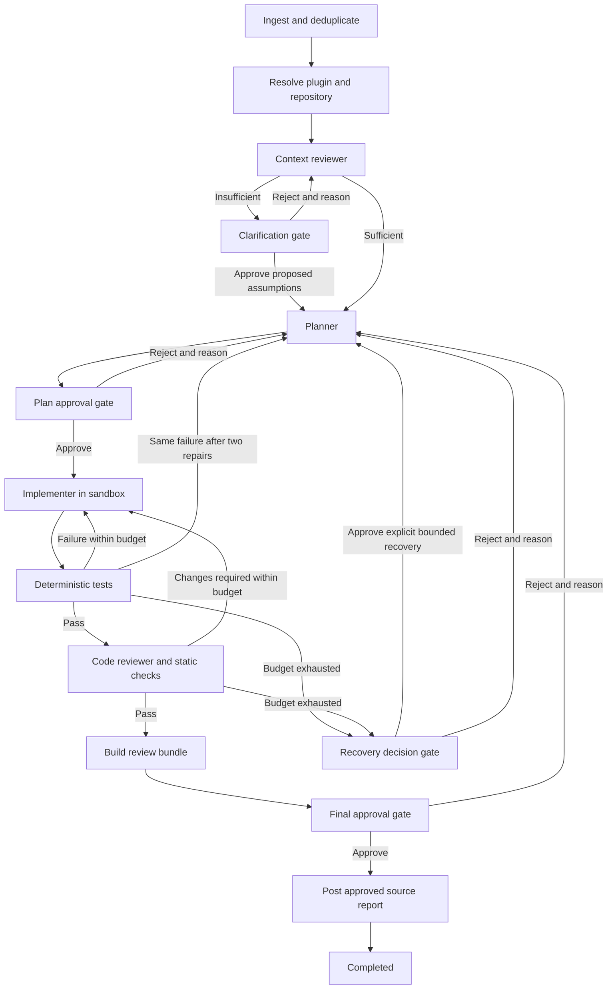
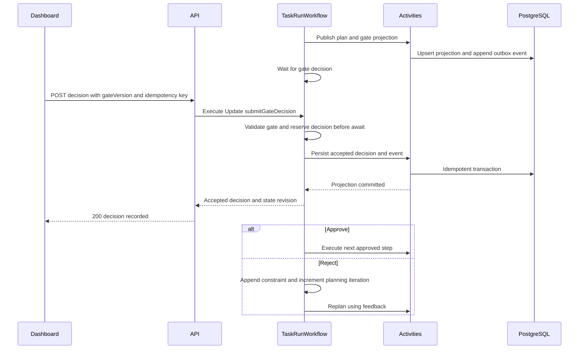
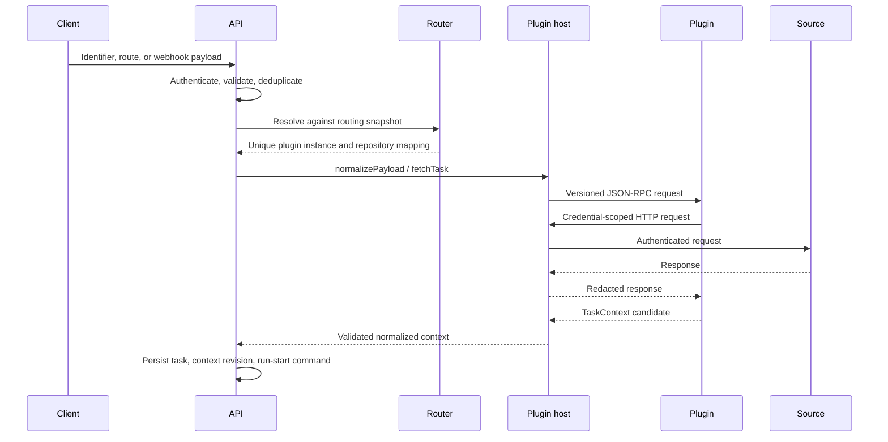
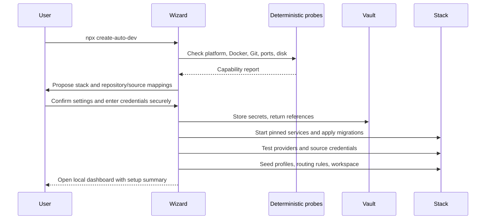
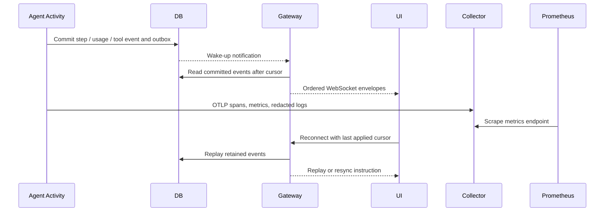

# 1. High-Level Architecture and Execution DAG

## 1.1 Operating envelope

The reference system serves one local workspace with one developer identity. It supports multiple repositories and concurrent runs, with a default maximum of two active sandboxes and four outstanding provider calls. Queue excess work rather than oversubscribing the machine. Target Windows with WSL2/Docker Desktop, macOS with Docker Desktop, and Linux with Docker Engine; use Linux containers for reproducible execution.

The control plane comprises host processes for CLI, API, dashboard, worker, plugin host, and a narrowly scoped sandbox broker. A Compose bundle supplies PostgreSQL, Temporal, the Collector, and Prometheus. Development may use Temporal's local development server, but supported releases use a pinned self-hosted Temporal service with persistent storage. Temporal uses a separate database and database role from product data.

All published ports bind to loopback. Internal containers communicate on a private network. Webhook delivery from internet sources is unavailable by default: polling and manual ticket ingestion work immediately. An opt-in user-managed tunnel forwards only signed webhook routes, never dashboard or administrative routes.

## 1.2 Components and package boundaries

| Component / package | Responsibility | Forbidden dependency |
| --- | --- | --- |
| `apps/cli` | Setup, lifecycle commands, export, diagnostics | Workflow internals |
| `apps/api` | Session security, validation, command dispatch, projections, WebSockets | Direct agent tool execution |
| `apps/dashboard` | React/Next.js UI; React Flow DAG; virtualized terminal | Secrets and Docker socket |
| `apps/worker` | Temporal workflows and Activity implementations | Browser session state |
| `apps/plugin-host` | Process supervision, RPC, capability broker | Workflow mutation |
| `apps/sandbox-broker` | Validated sandbox provisioning and cleanup | Arbitrary Docker API forwarding |
| `packages/contracts` | JSON Schema, generated TS types, HTTP/event vocabulary | Runtime services |
| `packages/plugin-sdk` | RPC client/server, connector utilities, conformance suite | Product database |
| `packages/providers` | Model capability negotiation and normalized results | Workflow scheduling |
| `packages/sandboxes` | Docker and E2B adapters | Agent planning logic |
| `packages/telemetry` | Correlation, redaction, metrics and span conventions | Raw credentials |
| `packages/prompt-compiler` | Versioned prompt IR and provider compilation | Network I/O in deterministic compilation |

Use strict TypeScript, ESM, pnpm workspaces, Turborepo task dependencies, Fastify for API/RPC gateway, and PostgreSQL migrations with parameterized queries. Generate public types from JSON Schema rather than maintaining two independent type systems. Next.js runs as a local server; API routes are served by Fastify behind the same loopback origin through a development/production proxy.

## 1.3 Workflow and execution DAG

Create `TaskRunWorkflow` with stable workflow ID `task/{taskId}/run/{runId}`. Pin the task context revision, base commit, agent profile revisions, prompt artifacts, routing decision, and policy snapshot in the run manifest. Use references and hashes in workflow history, keeping large prompts, patches, and logs in the artifact store.

Clarification gates present proposed assumptions, missing facts, and consequences. Approval accepts only those explicit assumptions. Rejection supplies corrections and reruns context review. If no safe assumptions exist, Approve remains disabled until the missing configuration/data is supplied in the inline context form. The gate still has only two primary actions.

Final approval authorizes the displayed source comment and configured status update, plus retention of the exact reviewed patch. It does not authorize merge or mutation of the original checkout. Reporter drafts are available locally before final approval. Failed source publication transitions to `REPORT_PENDING`; it must not rerun implementation or repeat a completed source write.

All rejected artifact versions become superseded. Final rejection invalidates plan and final approvals, preserves the base commit, feedback, and artifacts, and creates a fresh sandbox from that base for replanning. A changed upstream base commit creates a new run and requires plan approval.

## 1.4 Temporal state and decisions

Use workflow statuses from the reference contracts. Workflow code only coordinates deterministic decisions; provider calls, random/host values, file operations, PostgreSQL writes, and network calls belong in Activities. Use workflow-safe time/ID APIs and version markers. Retry Activities with capped exponential backoff; handle permanent validation/policy failures without retries.

The Update validator checks active gate ID/version, decision shape, actor, and reason. The handler reserves the gate synchronously before its first `await`, preventing concurrent decisions. Duplicate idempotency keys with the same canonical payload return the recorded result; a different payload returns `IDEMPOTENCY_CONFLICT`. Gate validation compares state, not just database records. Await all accepted message handlers before completing or continuing as new.

Temporal history is authoritative. Gate persistence Activities use `(run_id, gate_id, version)` and decision ID uniqueness to tolerate replay/retry. If the projection write is unavailable after the decision is durable, the API returns a pending/unknown response and the UI reconciles the same decision ID; it must not show a rejection or invite a new decision. Worker recovery retries the write and advances execution.

## 1.5 Plugin resolution sequence

## 1.6 Setup and telemetry sequences

## 1.7 Failure, side effects, and recovery

| Failure | Required behavior |
| --- | --- |
| API crashes after run command commit | Outbox dispatcher starts workflow with stable ID; duplicate start is harmless |
| Worker dies mid-tool call | Activity heartbeat and external operation ID reconcile the sandbox command before retry |
| Provider disconnects mid-stream | Retain partial usage as estimated/unknown; retry only within call and cost budget |
| Database unavailable | Stop product mutations; workflow retries persistence; no in-memory-only approval success |
| Temporal unavailable | API can show cached projections as stale; mutations return `503` or durable pending command |
| Plugin dies | Restart with bounded backoff; replay only idempotent reads or reconciled writes |
| Sandbox disappears | Recreate from manifest and last verified patch, rerun tests, require fresh final gate |
| Human absent | Gate waits without occupying an Activity or sandbox; optional reminders never auto-approve |
| Source write result unknown | Reconcile operation marker; otherwise mark delivery uncertain and require recovery |

The system guarantees at-least-once Activity execution, not universal exactly-once external effects. Use operation IDs and remote reconciliation. Sources lacking idempotency or searchable markers cannot safely retry uncertain comment/status writes automatically.

Default correction budgets: three test repair iterations, two reviewer repair iterations, five human replans per run, two structured-output repair attempts, and three transport attempts per external operation. A budget gate can approve one explicitly displayed extension; cumulative monetary/time caps require the same explicit extension and are never silently reset.

QA failures return automatically to implementation with the previous candidate and test evidence. A stable check/error fingerprint identifies repeated failures independently of candidate hashes and timestamps. If the same failure remains after two repair attempts, the workflow revises the plan and requires plan approval again. Different failures restart the persistence count, but replanning never resets the cumulative test repair budget. Budget exhaustion takes precedence and opens a recovery gate displaying the evidence, repairs used, and an explicit one-repair extension. Approving extends the budget and returns to planning; rejecting cancels the run.

Continue as new only at a quiescent boundary with no active tools, pending decisions, or handlers. Carry logical run ID, current state revision, pinned manifest references, counters, and unresolved constraints. The Temporal execution ID changes; public run ID and event cursors remain stable.

## 1.8 Local operations and evolution

`auto-dev up`, `down`, `status`, `doctor`, `backup`, and `restore` are the supported lifecycle surface. Bind dashboard/API to `127.0.0.1` on one origin and enforce an exact Host/Origin allowlist to resist cross-origin requests and DNS rebinding. Use an HttpOnly SameSite=Strict session cookie, a separate CSRF token for mutations, and a short-lived one-time bootstrap token exchanged through the URL fragment. WebSocket upgrades validate Origin and session cookie.

Back up product PostgreSQL, Temporal persistence, artifacts, configuration, and version manifests as one stopped/quiesced snapshot. Export secret references but never vault plaintext. Restore onto matching service/schema versions, then run migrations. A restored installation must reconnect or re-enter secrets and verify artifact hashes before resuming workflows.

Use expand/migrate/contract database changes and Temporal-compatible worker deployments. Pin container digests and produce a release manifest; never claim a development Temporal server is a production persistence strategy.

Temporal behavior is based on its [TypeScript guide](https://docs.temporal.io/develop/typescript), [message-passing semantics](https://docs.temporal.io/encyclopedia/workflow-message-passing), and [durable replay model](https://docs.temporal.io/tasks). Package versions are selected and locked when implementation begins.
