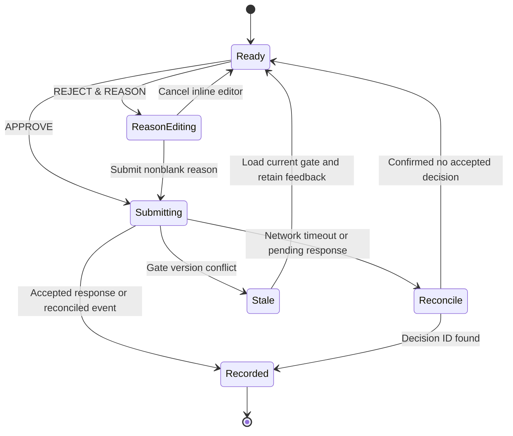

# 2. Dashboard UI/UX and Live Visual Design

## 2.1 Information hierarchy

The dashboard answers four questions in order: what needs my decision, what is running, what has changed, and what is it costing? The default screen retains the same layout across workflow transitions so moving agents do not make controls jump.

One Developer Army is designed to expand a solo developer's capacity without turning supervision into another full-time job. Group gates by run, prioritize blocking decisions, and suppress routine success notifications. The gate inbox shows only actionable items; users can silence decorative activity through calm/low-power mode without losing important state. Never reward long working hours or pressure the developer to clear a queue immediately.

| Zone | Desktop allocation | Contents |
| --- | --- | --- |
| Global header | 64 px high | Workspace, connection state, active/queued counts, gate inbox, tokens, priced cost, unpriced usage |
| Run navigation | 224 px left rail | Runs grouped by attention/running/queued/recent; repository and source identity |
| Execution canvas | Remaining center; minimum 480 px | Animated DAG, selected run summary, phase duration, progress based on completed steps |
| Live activity | 340–440 px right rail | Virtualized terminal, tool timeline, resource gauges, selected agent telemetry |
| Context inspector | Bottom drawer, 40–60% height | Plan, diff, test results, review findings, artifacts, configuration revisions |

At 1,280 px, collapse run navigation to icons and allow the activity rail to become a drawer. Below 900 px, use tabs for graph/activity/inspector and retain the decision card and header. Below 600 px, present a semantic step list instead of the DAG. Keep a user's selected agent, scroll position, and terminal follow mode when events arrive.

## 2.2 Component architecture

```text
DashboardShell
  SessionBoundary / ConnectionBanner / GlobalTelemetryHeader
  RunNavigation
  RunWorkspace
    RunSummary / DecisionGateCard
    ExecutionGraph (React Flow) / AccessibleStepList
    InspectorTabs (Plan, Diff, Tests, Review, Artifacts)
  ActivityRail
    AgentTelemetry / SandboxGauges / ToolTimeline
    VirtualTerminal (xterm.js, bounded scrollback)
  GateInbox / ToastRegion / KeyboardHelp
```

Use a typed REST client for snapshots and mutations, a single authenticated WebSocket for events, and a normalized client store keyed by run/step/gate ID. Server state fetches use TanStack Query. The event reducer applies only newer revisions and invalidates affected queries; React components never infer workflow transitions from terminal text or animation completion.

Diffs use a lazy-loaded viewer with file list, line numbers, syntax highlighting, and findings. Large artifacts load on demand. Render Markdown using a sanitized allowlist with raw HTML disabled. Treat terminal escape sequences, hyperlinks, source content, and model output as untrusted; disable terminal clipboard escape sequences and require explicit activation for external links.

## 2.3 Visual system and motion

Use a dark neutral foundation (`#0B1018` background, `#121B28` panels, `#223149` borders), cool cyan accents (`#65D8ED`), and high-contrast near-white text (`#E9EFF7`). Validate actual combinations against WCAG AA rather than relying on hex values alone. Use a readable sans font for labels and a monospace font for terminals and numeric metrics. Tabular numerals prevent cost tickers from shifting.

| State | Visual treatment | Text/icon requirement |
| --- | --- | --- |
| Queued | Muted border and clock | “Queued” and queue position |
| Running | Cyan border, 2 s soft pulse | Spinner and current operation |
| Awaiting human | Amber edge, steady attention marker | Gate type and age |
| Succeeded | Green check and stable edge | “Passed” or “Completed” |
| Retrying | Amber dashed edge | Attempt and remaining budget |
| Failed | Red error marker | Failure reason and recovery state |
| Offline/stale | Desaturated display | Last update timestamp |

Animate only active DAG edges using a low-opacity traveling dash. Nodes pulse while an actual step is running; waiting gates have steady indicators. Successful nodes settle immediately. No simulated log lines, invented utilization, or interpolated monetary values that could be mistaken for measured usage.

Token counts update at most 4 Hz from provisional stream estimates and reconcile to final provider usage. Prefix provisional values with `~`; show cost as “estimated USD,” price snapshot date, and separate unpriced calls. Sample CPU/RAM every second, retain a 60-point sparkline, and label missing readings as unavailable. Never show a missing metric as zero.

Use one animation clock per visible graph. Batch event rendering every 100 ms, process critical state/gate events immediately, and cap graph rendering at 30 fps. Hidden tabs stop animations and chart sampling; state continues to reconcile. Reduced-motion mode removes pulses, traveling dashes, count transitions, and chart interpolation. Low-power mode also pauses sparklines and caps noncritical UI updates to once per second.

## 2.4 Two-button gate behavior

The decision card includes gate title, immutable artifact revision/hash, assumptions, cost/time estimate, test summary when applicable, and the consequences of approval. Its only primary actions are `APPROVE` and `REJECT & REASON`. Pause/cancel run controls remain secondary global controls outside the gate.



Clicking Reject expands an inline textarea, focuses it, and retains both original actions with Approve disabled while editing. `Submit feedback` and `Cancel` are secondary editor controls, not additional workflow outcomes. Require 1–8,000 non-whitespace characters. Store the draft locally by gate/version; clear it after confirmed acceptance. Future voice input fills this same text field and requires explicit submission.

Disable decision controls while submitting. Do not optimistically advance the DAG. Generate one idempotency key per intent and reuse it on retry. A `202` or network timeout displays “Confirming your decision…” and reconciles the key with the server. A version conflict displays the current gate alongside retained feedback; it never silently submits old feedback against the new plan.

Example request:

```json
{
  "protocolVersion": "1.0",
  "runId": "10000000-0000-4000-8000-000000000001",
  "workflowId": "task/20000000-0000-4000-8000-000000000001/run/10000000-0000-4000-8000-000000000001",
  "gateId": "30000000-0000-4000-8000-000000000001",
  "expectedGateVersion": 1,
  "decision": "REJECT",
  "reason": "Keep the existing public API and add a compatibility test.",
  "idempotencyKey": "40000000-0000-4000-8000-000000000001"
}
```

The API derives actor and receipt time from the authenticated local session; the client cannot impersonate an actor or backdate a decision. Approval binds to the exact gate artifacts and policy snapshot. The workflow appends rejection feedback as a constraint with provenance; it does not allow feedback to override platform tool restrictions.

## 2.5 Accessibility and operational states

- Provide a keyboard-accessible step list equivalent to the graph, visible focus rings, skip links, and focus restoration after gate completion. Graph position never determines tab order.
- Do not assign unmodified global shortcuts to approval. `Ctrl/Cmd+Enter` submits only inside the focused rejection form. Screen readers announce gate arrival and completion, not each token or log chunk.
- Support 200% zoom, color-independent status labels, high contrast, reduced motion, and touch targets at least 44 px.
- Empty state explains how to connect a source or ingest a task. An offline banner preserves cached content with timestamps and disables mutations until reconnection.
- An event retention gap pauses live presentation, fetches a fresh snapshot, and restores the selected run. A log truncation marker links to the complete retained artifact when available.

Acceptance targets: a visible gate appears within 1 second of its committed event under the local reference workload; 10,000 retained terminal lines and a 100-node graph remain usable during 100 noncritical events/s; critical decisions bypass batching. Measure input responsiveness and memory on a documented reference machine rather than claiming hardware-independent performance.

## 2.6 Workspace settings and agent work horizon

Open **Settings** in the header for the agent work horizon, low-power mode,
connection controls, and read-only configured agent profiles. Configuration is
workspace-scoped; task inspection contains Plan, Diff, Tests, and Review.

Migration `006_work_horizon.sql` stores horizon settings and manual overrides.
The default permits dated tasks through today plus seven calendar days, inclusive,
using `Europe/Brussels`. Overdue tasks qualify; undated tasks wait for a manual
override. Settings accept 0–365 days and an IANA timezone. Connector ingestion and
refresh remain unrestricted. The Jira planning extension supplies the planned date;
sources without a planned date are treated as undated.

The authenticated `GET/POST /api/v1/work-horizon` endpoint reads/saves the policy.
`POST /api/v1/tasks/:id/work-horizon` sets `{allowed, reason}` for an individual
task. The dashboard labels this **Allow work now**; it enables queued work without
creating a new run. Override state persists until explicitly revoked.

Run-start requests outside the horizon return `DEFERRED` and remain queued.
Dispatch checks the latest available planning context before starting Temporal,
while retaining the run's pinned execution context. Deferred commands are rechecked
within one minute; settings changes and overrides wake them immediately. Started
workflows continue unaffected, including when the horizon shrinks.

## 2.7 Workspace operations

Apply migration `007_workspace_operations.sql` before running the current API or
worker. It stores workspace spending policy, role assignments, and run admission
reservations. Existing signed release artifacts describe their original schema;
they are not regenerated by dashboard changes.

- Execution follows the event journal every two seconds, with a 15-second snapshot
  fallback. Epoch changes and retention gaps cause a fresh snapshot. Focused
  decision drafts survive background updates. Execution, connector, and telemetry
  freshness are shown separately.
- Backlog filters distinguish eligible, deferred, undated, and overridden tasks.
  Queued runs show horizon dates, capacity, paused-work, budget, pricing, and
  provider/backend waiting reasons. Deferred cancellation is handled locally
  without starting a Temporal workflow; repeated cancellation requests deduplicate.
- Spending settings support daily and per-task USD caps, a per-run reservation,
  maximum concurrent runs, pause/resume of new work, and an unpriced-usage policy.
  Concurrency includes approval waits. Daily totals follow the configured calendar
  timezone. Started runs are not cancelled by pausing new work.
- Admission is serialized per workspace. Priced call reservations are checked
  against daily and task limits before execution. Unknown prices may exceed a
  monetary cap when explicitly allowed; block them for strict priced admission.
- GitHub and Jira Cloud connector configuration persists in `source_plugins`.
  Fetches are read-only, origin-scoped, bounded by a timeout, and do not follow
  redirects. Credentials are environment references only: the environment variable
  contains the complete Authorization header value. Repository setup must already
  exist and a pinned commit SHA is required.
- Ingested task revisions are durable and reload at startup. Agent profiles are
  stored as immutable revisions, with editable role assignments for future runs.
  Run starts pin profile identity/revision/model metadata. The current workflow
  execution backend remains deterministic; assigning a live model does not enable
  live model calls. Unsupported execution and missing credentials are reported as
  waiting states rather than silently substituting another model.
- Contribution drill-downs show attributed tasks, steps, attempts, iterations, and
  spend per attributed completed step for the five-minute window. Transport retry
  counts remain unavailable until the producer records them.
- The terminal starts collapsed. Dashboard filters, view, low-power mode, and
  terminal expansion persist on the device. Returning visitors see completions,
  failures, pending decisions, and known spend since the previous visit.

Operational API routes use the local session and require CSRF on POST:
`GET/POST /api/v1/operations`, `GET /api/v1/configuration`,
`POST /api/v1/connectors`, `POST /api/v1/connectors/sync`,
`POST /api/v1/profiles`, and `POST /api/v1/assignments`.
