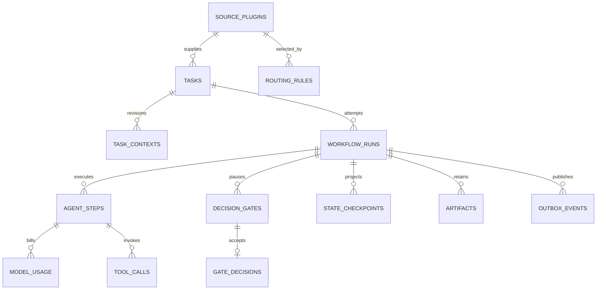

# 6. Unified Data, Context, and API Contracts

## 6.1 Normative artifacts

The [PostgreSQL DDL](reference/schema.sql), [TypeScript contracts](reference/contracts.ts), and [JSON Schemas](reference/schemas.json) form the reference baseline. SQL uses `snake_case` physical names: `tasks` corresponds to **Tasks**, `routing_rules` to **RoutingRules**, and so on. Public APIs use camelCase. Use UUIDs for identity, decimal strings for 64-bit cursors and monetary values, UTC timestamps, and SHA-256 for artifact hashes.

JSON Schema 2020-12 is the source for public payload validation and generated TS types in the future implementation. The checked-in TS declarations are reviewable reference interfaces; the roadmap replaces their manual synchronization with generation before the SDK is released. Validate unknown inputs at every boundary, including plugin/provider responses. Strict response parsing is mandatory even when a provider claims structured-output support.

## 6.2 Persistence model

| Logical table | Physical table | Purpose and invariants |
| --- | --- | --- |
| Tasks | `tasks` | Stable source identity; current context revision pointer |
| TaskContexts | `task_contexts` | Immutable normalized context documents and hashes |
| RoutingRules | `routing_rules` | Versioned matcher and target mapping |
| SourcePlugins | `source_plugins` | Configured instance, manifest/digest, grants, secret refs |
| AgentProfiles | `agent_profiles` | Immutable profile revisions; unique name/revision |
| WorkflowRuns | `workflow_runs` | Logical run, pinned manifest, latest projected state |
| AgentSteps | `agent_steps` | Logical agent execution and outcome |
| ModelUsage | `model_usage` | Immutable billable attempt facts and nullable accounting |
| UsageAdjustments | `usage_adjustments` | Final reconciliations without rewriting prior facts |
| PricingSnapshots | `pricing_snapshots` | Immutable model/category price documents |
| ToolCalls | `tool_calls` | Operation ID, policy/result, duration and artifacts |
| RetryAttempts | `retry_attempts` | Distinguish semantic correction loops and transport retries |
| DecisionGates | `decision_gates` | Artifact-bound gate versions and pending/decided state |
| GateDecisions | `gate_decisions` | Immutable server-attributed accepted decisions |
| TelemetryLogs | `telemetry_logs` | Durable redacted event details |
| StateCheckpoints | `state_checkpoints` | Immutable query snapshots linked to Temporal execution |
| Artifacts | `artifacts` | Hash, media type, size, storage locator, retention metadata |
| SecretsMetadata | `secrets_metadata` | Opaque vault reference and owner scope only |
| OutboxEvents | `outbox_events` | Ordered retained domain event journal |
| ExternalOperations | `external_operations` | Intent/receipt/reconciliation journal for source writes |

Auxiliary tables include `workspaces`, `repositories`, `workspace_event_counters`, `ingest_deliveries`, and `command_requests`. A fixed v1 workspace ID is still stored in rows to make ownership explicit; it does not constitute a complete tenant-isolation implementation.



Use foreign keys, nonnegative quantity checks, unique operation IDs, and partial uniqueness for one active run per task by default. Writes to audit tables go through append-only database-role grants; retention maintenance uses a distinct privileged path. JSONB is appropriate for validated versioned payloads, not an excuse to omit identifiers, timestamps, or critical indexes.

`state_revision` increments on each projected workflow transition. Projection Activities compare revisions so out-of-order retries cannot overwrite newer state. A checkpoint includes logical run ID, Temporal workflow/execution ID, manifest hash, state revision, and query snapshot; it cannot resume execution independently of Temporal history.

## 6.3 TaskContext and profiles

The canonical context contains source instance/external ID/key/URL/revision, repository ID/base SHA, text, acceptance criteria, attachment metadata, labels, requester, constraints, and provenance. The server supplies local repository mappings, ingestion timestamp, and policy constraints. Descriptions are untrusted task content and must not be elevated into platform instructions.

Example is stored in [task-context.example.json](reference/task-context.example.json), validated against `#/$defs/TaskContext`. Important bounds: title ≤500 characters, description ≤200,000, ≤100 acceptance criteria, ≤100 attachments, ≤100 labels, ≤200 constraints. Attachment bytes are fetched separately after size/type policy checks.

Profiles are immutable revisions. The `provider` discriminator selects runtime capability checks for the bounded `providerOptions` object; arbitrary provider fields are not forwarded. Prompt, policy, output schema, and tool grants are explicit. The [profile example](reference/agent-profile.example.json) validates against `#/$defs/AgentProfile`; its illustrative model name is resolved/validated during setup and is not a claim that a specific model exists.

## 6.4 HTTP API surface

All routes are under `/api/v1` and use the single local session. JSON request bodies are limited to 1 MiB; webhook routes have source-specific limits up to 2 MiB. Require `Idempotency-Key` for mutation commands and content type `application/json` except raw signed webhook bodies. State-changing routes require CSRF protection. API, event, and plugin protocol versions evolve separately.

| Method and path | Request / response | Semantics |
| --- | --- | --- |
| `POST /tasks/ingest` | identifier/source hint or payload → task/context/command IDs | Durable ingestion and route resolution |
| `POST /hooks/:instance/:route` | Raw signed source payload → `202` delivery receipt | Signature and replay validation before dispatch |
| `GET /tasks/:id` | Task and context revisions | Redacted source content |
| `POST /tasks/:id/runs` | contextRevision, repositoryId, baseSha → `202` run ID | Persist command before Temporal start |
| `GET /runs` | Filters/cursor → page | Stable keyset pagination |
| `GET /runs/:id` | Run, steps, current gate, manifest refs | Projected state and freshness |
| `GET /runs/:id/gates/:gateId` | Gate/version/artifact hashes | Exact approval target |
| `POST /runs/:id/gates/:gateId/decisions` | GateDecisionInput → decision receipt or pending ID | Temporal Update, one winner per version |
| `GET /decisions/by-key/:key` | Recorded/pending/absent | Reconcile a network timeout |
| `POST /runs/:id/cancel` | expectedStateRevision, reason → `202` | Durable cooperative cancellation request |
| `GET /snapshot` | Full projections + snapshotCursor + journalEpoch | Consistent stream bootstrap |
| `GET /events/history` | after, limit ≤500 → envelopes | Journal replay with retention metadata |
| `GET /events` (upgrade) | after + epoch → WebSocket | Session/Origin-validated event stream |
| `GET /artifacts/:id` | Restricted byte stream | Content-Disposition, hash, safe media type |
| `GET/POST /plugins` | List / install configured instance | Explicit image/digest and capability grants |
| `PATCH /plugins/:id` | expectedRevision, config/grants → revision | New configuration snapshot |
| `POST /plugins/:id/health` | Read-only health result | No source write test |
| `GET/POST /routing-rules` | List / create validated rule | Reject invalid regex/config |
| `POST /routing-rules/resolve-preview` | identifier/route → candidate ranks | Read-only matching |
| `GET/POST /profiles` | List / create immutable profile revision | Validate model/tool capability compatibility |
| `POST /profiles/:id/compile` | intent + template revision → artifact/hash | Bounded optional soul generation, then compile |
| `POST /setup/validate` | Redacted proposed config → probe results | Local bootstrap authorization required |
| `GET /health/live`, `GET /health/ready` | Component status | Never include secrets or source payloads |

Plugin installation and filesystem selection can only originate from the authenticated local configuration UI/CLI, never from source webhooks or agent tool calls. Secrets are entered through the local vault interface, not arbitrary profile/plugin JSON bodies.

Response shape for a completed decision:

```json
{
  "decisionId": "70000000-0000-4000-8000-000000000001",
  "status": "RECORDED",
  "gateVersion": 1,
  "stateRevision": 13,
  "recordedAt": "2026-10-26T10:02:00Z"
}
```

On deadline expiry, return `202` with `status=PENDING`, a command/decision lookup key, and no claim that execution has advanced. A retry uses the same idempotency key. Keys are retained for at least the associated run/audit retention window. Reusing a key for another payload returns `409`.

## 6.5 Error contract and transition validation

```json
{
  "error": {
    "code": "GATE_VERSION_CONFLICT",
    "message": "This gate has been superseded.",
    "retryable": false,
    "requestId": "request-123",
    "details": {"currentGateVersion": 2}
  }
}
```

| Status | Codes |
| --- | --- |
| `400` | `VALIDATION_FAILED`, `INVALID_CURSOR`, `INVALID_WEBHOOK` |
| `401/403` | `AUTH_REQUIRED`, `CSRF_FAILED`, `ORIGIN_DENIED`, `POLICY_DENIED` |
| `404` | `NOT_FOUND`, `ROUTE_NOT_FOUND` |
| `409` | `GATE_VERSION_CONFLICT`, `GATE_ALREADY_DECIDED`, `IDEMPOTENCY_CONFLICT`, `ROUTE_AMBIGUOUS`, `STATE_CONFLICT` |
| `410` | `EVENT_CURSOR_EXPIRED`, `ARTIFACT_EXPIRED` |
| `422` | `UNSUPPORTED_CAPABILITY`, `UNSUPPORTED_STATUS`, `INVALID_PROFILE` |
| `429` | `RATE_LIMITED`, with bounded `Retry-After` |
| `503` | `TEMPORAL_UNAVAILABLE`, `DATABASE_UNAVAILABLE`, `PLUGIN_UNAVAILABLE` |

State invariants: tests and reviewer checks must pass against the exact final patch hash; final approval cannot approve a superseded artifact; a policy-denied tool does not execute; cancellation revokes pending gates and stops new tools; a completed run cannot be resumed by an old Update. Retry budgets are logical run counters and survive process restarts/continue-as-new.

## 6.6 Schema migration and compatibility

Version JSON documents with `schemaVersion`; version event envelopes with `protocolVersion`. Accept compatible minor versions and preserve unknown optional extensions in a namespaced `extensions` field. Reject unsupported major versions and unknown core properties at input boundaries. Introduce new required fields only with a major schema change or explicit migration.

Use migration IDs/checksums and one advisory lock per product database. Apply expand changes before deploying code that uses them; backfill in bounded batches; contract only after old workers/runs have drained. Export manifests record database migration head, Temporal/service versions, plugin digests, JSON schema versions, and artifact hashes. The SQL reference is a fresh-install schema baseline, not an incremental production migration script.
