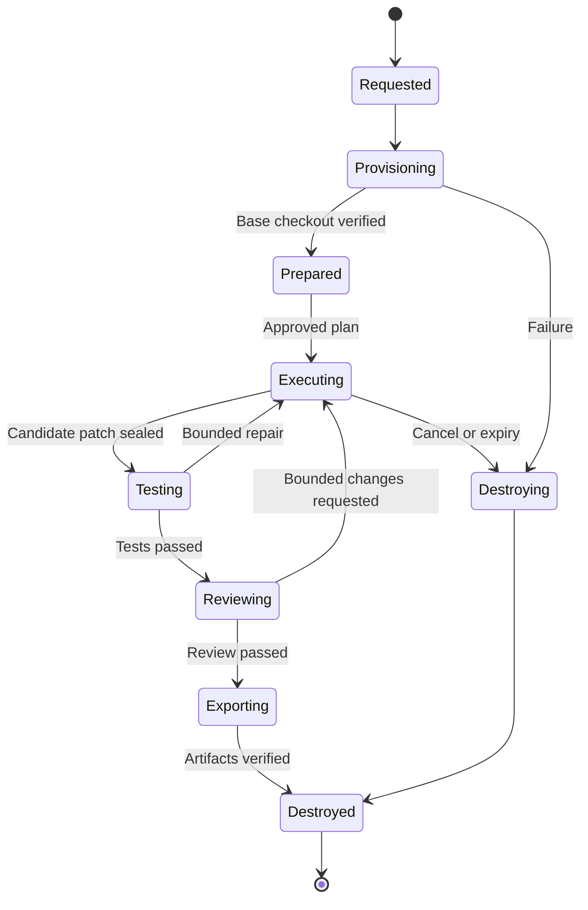

# 8. Sandbox Execution Architecture

## 8.1 Backend contract and lifecycle

The [SandboxProvider interface](reference/contracts.ts) gives workflows one lifecycle across Docker and E2B: `create`, `prepareRepository`, `execute`, `applyPatch`, `collectArtifacts`, `inspectResources`, and `destroy`. Every call accepts a run-scoped operation ID and deadline. The broker owns backend credentials, policy validation, resource enforcement, and cleanup; agents receive only a sandbox handle and registered tools.

Destroy the sandbox before long human waits whenever artifacts and a reproducible manifest suffice. Gate #1 normally precedes provisioning. Gate #2 retains patches, logs, reports, image digest, environment manifest, and dependency lockfile hashes; it does not keep a live shell. Recovery rebuilds and reruns tests if execution state must be recreated.

## 8.2 Repository preparation

Resolve a user-approved repository ID to a host-controlled path and base commit. Build an isolated repository snapshot from the committed base, preserving metadata needed by tooling without mounting the original checkout or exposing its credential helpers. A task cannot select a path such as the home directory. Dirty user changes are shown during setup; only an explicit snapshot/import workflow may include them, with its own content hash and approval target.

Use a read-only export of tracked content and a sandbox-local Git repository initialized at the pinned base tree. Disable host Git hooks, signing, credential helpers, and unsafe filters. Submodules and Git LFS are opt-in prepared inputs with their own pinned revisions; never auto-fetch arbitrary URLs from repository files. Repositories requiring unsupported special filesystem behavior fail preparation with an actionable error.

Build images from maintained project templates, pinned by digest, containing Node/Python/Git and approved test tools. Dependency installation is a separate preparation command with network policy and time limits; lifecycle scripts execute as untrusted code under sandbox policy. Retain lockfile integrity and package-manager versions; an agent cannot edit locks to bypass a policy check invisibly.

## 8.3 Docker defaults and host protection

| Control | Default |
| --- | --- |
| User | Non-root UID/GID; no sudo |
| CPU / RAM | 2 CPUs / 2 GiB RAM per sandbox |
| Processes / scratch | 256 PIDs / 4 GiB writable workspace quota |
| Root filesystem | Read-only, bounded tmpfs for `/tmp` |
| Privileges | Drop all capabilities; `no-new-privileges`; default seccomp |
| Network | Deny egress; approved dependency-fetch stage through scoped proxy |
| Mounts | Dedicated run volume only; no host checkout, home, SSH, or Docker socket |
| Timeouts | 10 min per command, 30 min sandbox lifetime, bounded extensions |
| Output | 10 MiB command capture then explicit truncation/failure policy |

Use rootless Docker on supported Linux hosts when available; Docker Desktop uses its VM boundary. Detect unsupported quota/cgroup controls and fail closed for required limits, rather than claiming limits are enforced. Disk quotas require a supported volume/storage mechanism or broker-enforced byte accounting plus hard volume limit; do not treat memory limits as disk limits.

Only the sandbox broker can reach the Docker daemon. Its API accepts validated image IDs and fixed resource/mount templates; it cannot forward arbitrary Docker options from the API, plugin, or model. Docker's [daemon security model](https://docs.docker.com/engine/security/) and [resource constraints](https://docs.docker.com/engine/containers/resource_constraints) inform these requirements. Containers still share a kernel with their host/VM; the design does not claim protection equivalent to dedicated hardware.

Egress enforcement uses a network-isolated sandbox plus a separately authenticated proxy with hostname, resolved IP, method, port, and path policy. Do not allow raw direct networking while claiming a DNS allowlist is sufficient. Block cloud metadata and private/loopback destinations. Model calls originate in the trusted worker, so provider credentials are never needed inside the sandbox.

## 8.4 Commands, patching, and tests

`execute` accepts executable plus argument array, relative working directory, allowlisted environment variables, deadline, and operation ID. Spawn without a host shell. If a repository requires a shell script, execute an explicit sandbox-local script interpreter; all resulting code stays under sandbox restrictions. The agent cannot promote a sandbox command into a host command.

A sandbox-local execution supervisor records operation ID, PID/process group, start/end, exit code, and output offsets. Repeated operation IDs return the receipt or reconnect to an active command. After worker failure, reconcile before retrying. Cancellation sends graceful termination, waits up to five seconds, then kills the process group and marks partial artifacts. The broker watchdog destroys expired/stranded sandboxes even if Temporal workers are unavailable.

Unified diff application follows this protocol:

1. Record the expected base/tree hash and validate diff size ≤5 MiB, file count ≤200, and path limits.
2. Reject absolute paths, traversal, device files, unsafe symlink targets, changes outside the repo, and protected `.git`/platform policy paths. Validate resolved paths after symlink checks, including case/drive behavior on the host export boundary.
3. Run `git apply --check` against a temporary sandbox tree and reject conflicts; never silently use a three-way apply that changes the review target.
4. Apply atomically to a candidate tree, compute a canonical full diff from the pinned base, and record its SHA-256. Capture agent direct writes through this same final diff/validation path.
5. Seal the candidate while tests/review run. Any file change invalidates prior test/review receipts and final gate artifacts.

Binary changes require an explicit artifact-capable patch format and review support; v1 rejects them with a clear error rather than emitting a misleading unified diff. Large generated files and lock changes receive explicit review labels.

Test runner selection is deterministic: an explicit workspace test configuration wins; otherwise choose the single supported lockfile/package manager and package script or Python configuration discovered by a non-executing probe. If multiple plausible commands exist, ask at setup or open a clarification gate. No test script is invented by a model and then presented as the repository's existing suite.

Supported v1 adapters: npm/pnpm/yarn package scripts with pinned package-manager version, pytest, and a configured argv command. Store command, image digest, base/patch hashes, environment fingerprint, exit code, duration, stdout/stderr artifacts, and JUnit/JSON reports. A zero exit code with no discovered tests is `NO_TESTS` unless an approved policy explicitly accepts it. Run configured lint/type/static/security checks as separately reported commands. Flaky reruns are visible and never erase the original failure.

## 8.5 E2B parity and artifacts

E2B is opt-in and sends repository content to a remote execution service. Setup explains that data transfer and tests capabilities before enabling it. The adapter maps creation, command streaming, file transfer, timeout, and teardown to the normalized contract. E2B supports its own sandbox lifecycle; adapter behavior must be verified against the pinned SDK and account limits rather than assuming Docker flags have equivalents. [E2B lifecycle documentation](https://docs.e2b.dev/sandbox)

Each backend returns a capability report. If it cannot enforce a required network, resource, timeout, or artifact policy, reject the run with `UNSUPPORTED_CAPABILITY`; never silently weaken policy. Model prices and sandbox compute charges are separate ledger categories, and the UI distinguishes unknown remote compute cost.

Artifacts are written to temporary files, hashed, scanned for intentional credential exposure where relevant, then atomically registered in the artifact store and PostgreSQL. Store no arbitrary host path supplied by a plugin/model; storage locators are opaque and resolved by the broker. Hash verification precedes final approval and export. A review bundle contains plan, constraints, final diff, test/static reports, reviewer findings, usage summary, run manifest, and sanitized source-comment draft.

Destroy is idempotent. Reconciliation enumerates only broker-labeled resources with matching workspace/run IDs and checks the broker registry before removal. Never delete unrelated Docker containers or images. Cleanup failure sets a visible leak alert and retries with a finite schedule; run completion can retain that operational warning without pretending resources were removed.

Acceptance covers traversal/symlink attacks, malicious hooks, metadata egress, required-limit failure, duplicated command operations, cancellation during tests, worker crash, expired E2B handles, log overflow, candidate mutation after tests, no tests discovered, failed atomic patching, and orphan cleanup without touching unrelated resources.
