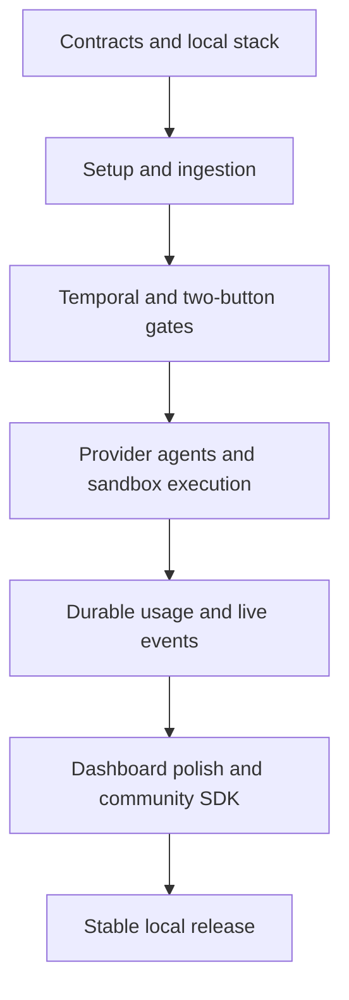

# 9. Phased Open-Source Implementation Roadmap

## 9.1 Delivery rules and dependency order

This roadmap builds the platform described by the specification. The repository's present deliverable is the documentation and reference contracts; phase completion below refers to future executable releases. Each phase produces a usable vertical slice and a tagged release with a migration/compatibility manifest. Durability and policy controls ship with the behavior they protect.

Use risk-based milestones rather than calendar promises. A small team can parallelize within a phase only after its shared contract gate passes. Implement fake connectors/providers/sandboxes first to make fault scenarios reproducible without credentials or charges.

## 9.2 Phase 1 — Setup and ingestion engine

Prerequisites: approve the specification baseline, select maintainers, establish Apache-2.0 licensing, and choose stable dependency/container versions. No executable platform is assumed.

| Order | Work package | Concrete deliverable |
| --- | --- | --- |
| 1.1 | Repository foundation | pnpm/Turborepo workspace; strict TS; package boundaries; lint/format/build scripts; CI; license/notices; dependency policy |
| 1.2 | Contract pipeline | JSON Schema validators and generated public TS types; API error contract; schema compatibility fixtures |
| 1.3 | Local infrastructure | Pinned Compose services, separate Temporal/product DBs and roles, persistent volumes, readiness probes, release manifest |
| 1.4 | Product persistence | Ordered migrations, workspace/repository/plugin/routing/task tables, command/outbox transaction helpers |
| 1.5 | Bootstrap CLI | Deterministic probes, setup action journal, vault adapters/fallback, config writer, resume/rollback, doctor |
| 1.6 | Plugin execution | Container-wrapped stdio process host, handshake/deadlines, broker grants, circuit breaker, RPC SDK |
| 1.7 | Routing and connectors | RE2 resolver/preview, fake/GitHub/Jira connectors, signed webhook path, polling/manual ingestion, delivery deduplication |
| 1.8 | Release slice | `npx create-auto-dev` provisions local services and ingests a source task into a validated context |

Exit criteria:

- A clean supported machine completes setup using documented prerequisites; a second run resumes/reuses owned resources without duplicate secrets or migrations.
- Manual GitHub/Jira identifiers resolve to the intended repository/plugin using previewed rules. Ambiguities and malformed input fail deterministically.
- A hostile plugin cannot reach the host filesystem, Docker daemon, private endpoints, or credentials through the supported wrapper/broker.
- A duplicate webhook returns the original receipt. A crash after durable ingestion is reconciled without creating duplicate tasks.
- Fake-source conformance, migration rollback-on-error, vault failure, scope denial, auth expiry, and source timeout scenarios pass.

Observability: structured redacted setup/RPC logs, request correlation, plugin health, routing latency, and ingestion counters. Rollback: stop newly created application services, retain data volumes, and restore prior config; migrations use compatible forward repairs. Next-phase boundary: no model-written code, full workflow execution, or polished dashboard is required.

Release artifacts: CLI package, container digest manifest, migration bundle, schemas, plugin SDK preview, connector images/SBOMs, setup guide, and known limitations.

## 9.3 Phase 2 — Durable state machine and HITL

Prerequisites: Phase 1 exit gate, stable task/context identity, an available Temporal service, and fake provider responses.

| Order | Work package | Concrete deliverable |
| --- | --- | --- |
| 2.1 | Workflow foundation | `TaskRunWorkflow`, task queues, Activity boundaries, run manifests, correction budgets, workflow versioning policy |
| 2.2 | Command dispatch | Durable run-start/cancel command outbox, stable workflow IDs, pending receipt lookup, idempotency conflict checks |
| 2.3 | Context and planning | Read-only repository inventory tools, fake-backed context/planner Activities, structured plan/clarification schemas |
| 2.4 | Projection pipeline | Revision-guarded run/step/checkpoint updates and commit-ordered event journal |
| 2.5 | Human gate protocol | Typed Temporal Updates, concurrent decision reservation, rejection constraint ledger, gate supersession, feedback preservation |
| 2.6 | Minimal control UI | Run list, readable plan, accessible gate card, inline reason editor, offline/stale/pending states |
| 2.7 | Recovery and cancellation | Worker/API restart recovery, exhausted-budget gate, cooperative cancellation, continue-as-new safe boundary |
| 2.8 | Demonstration | Ingest → clarify → plan → reject → replan → approve with a fake completion Activity |

Exit criteria:

- Restart API, worker, and Temporal at each gate boundary; the exact gate and artifact revision survive.
- Submit two simultaneous decisions; only one wins. Same-key retries return the same receipt; different-payload reuse fails.
- Network loss after a durable decision reconciles without a second decision. Stale gate versions never approve newer artifacts.
- Rejection feedback appears in the next planner input as a provenance-bearing constraint; platform tool restrictions remain effective.
- Cancellation revokes pending gates and prevents new Activities; no idle Activity holds a human wait.
- Replay compatibility tests cover the initial workflow version and a compatible evolution. Projection replay cannot overwrite newer state.

Observability: transition latency, pending gates, gate wait time, projection lag, Activity retries, and command-dispatch failures. Rollback: deploy compatible prior workers with pinned workflow versions; keep schema expansion compatible. Next-phase boundary: agents still use fake provider/execution backends for the acceptance path.

Release artifacts: API contract, Temporal worker image, minimal dashboard, fake-run demo, workflow replay fixtures, local recovery runbook, and upgrade compatibility report.

## 9.4 Phase 3 — Agents, sandboxes, and telemetry

Prerequisites: Phase 2 durability/gate acceptance, a constrained Docker broker, and approved provider/sandbox capability schemas.

| Order | Work package | Concrete deliverable |
| --- | --- | --- |
| 3.1 | Profiles and prompts | Profile editor/API, capability validation, SoulSpec expansion, deterministic compiler, prompt artifacts/hashes |
| 3.2 | Provider adapters | Fake provider first; then Ollama, OpenAI, Anthropic, Gemini, OpenRouter, Bedrock; fixture contract tests and opt-in live probes |
| 3.3 | Docker execution | Base snapshot, safe images, resource/egress policy, command supervisor, idempotent receipts, patch sealing, orphan cleanup |
| 3.4 | QA/reviewer loop | Deterministic runner discovery, test/static reports, bounded repairs, patch-bound evidence, final gate bundle |
| 3.5 | Usage accounting | Immutable usage attempts, reconciliation adjustments, versioned prices, reservation/budget engine, unpriced state |
| 3.6 | Live telemetry | Outbox replay, snapshot cursors, epoch handling, WebSocket backpressure, redacted logs, OTel/Prometheus pipeline |
| 3.7 | Optional E2B | Capability parity checks, explicit remote-data consent, compute accounting, timeout/cleanup adapter |
| 3.8 | Reporter integration | Approved comment/status publication, external operation journal, marker reconciliation, `REPORT_PENDING` recovery |

Exit criteria:

- Golden path passes on a fixture repository: ingest → plan → reject → replan → approve → implement → tests → review → final approve → source report.
- The final gate references the exact diff tested and reviewed. Mutating that candidate invalidates previous evidence.
- Filesystem traversal, symlink escape, privileged commands, Docker socket access, metadata egress, and missing required limits are blocked in backend integration checks.
- Worker death during a command reconnects to the operation receipt; tests are not silently duplicated. Sandboxes are cleaned after success, cancellation, and expiry.
- Usage categories reconcile without double counting retries/cache/reasoning. Unknown prices remain unpriced. Exhausted budgets stop new provider calls.
- Disconnect/reconnect, journal retention gaps, backup epoch changes, slow clients, log overflow, and Collector outage preserve correct product state.
- Source publication timeouts reconcile or become visibly uncertain; they never trigger a fresh implementation run.

Observability: all metrics in Chapter 3, per-provider adapter health, sandbox leak count, usage reconciliation errors, and redaction failures. Rollback: stop scheduling new runs, retain immutable manifests/artifacts, and drain or pause compatible workers; do not remove data required by existing workflows. Next-phase boundary: visual polish and public community onboarding remain incomplete.

Release artifacts: provider/sandbox packages, hardened images, prompt templates, full execution demo, cost-accounting fixtures, security-focused integration report, and retention/export tools.

## 9.5 Phase 4 — Dashboard polish and community SDK

Prerequisites: Phase 3 vertical slice, measured event workload, stable contract version, and supported local upgrade path.

| Order | Work package | Concrete deliverable |
| --- | --- | --- |
| 4.1 | Dashboard composition | Stable three-zone layout, run filtering, graph/step-list parity, inspector, diff and test views |
| 4.2 | Live visual feedback | Truthful token/cost counters, resource gauges, activity timeline, pulsing active nodes, sampled sparklines |
| 4.3 | Accessibility/performance | Reduced motion, keyboard/focus flows, responsive layouts, virtualized terminal, batching, low-power/hidden-tab behavior |
| 4.4 | Configuration experience | Plugin grants/health, route preview, profile/prompt preview, budget/retention editing, setup repair |
| 4.5 | Community SDK | `create-task-source-plugin`, TS starter, Python protocol starter, fake fixtures, conformance command, compatibility matrix |
| 4.6 | Release operations | Backup/restore drill, safe diagnostic bundles, signed manifests, SBOM/dependency/license review, vulnerability reporting policy |
| 4.7 | Stable release | Documented installs/upgrades on Windows/macOS/Linux; reproducible examples; release notes and contributor guide |

Exit criteria:

- Gate actions are operable by keyboard and screen reader; rejection text survives reconnection/version conflict; no approval depends on animation.
- The documented reference machine handles 100 noncritical events/s, 10,000 terminal lines, and a 100-node graph without unbounded memory growth.
- Reduced-motion and low-power modes meet the documented behavior. Empty, error, stale, offline, and expired-artifact states are complete.
- A new connector passes conformance using only the public SDK and documented broker grants; core source changes are unnecessary.
- A clean backup restores product/Temporal data and artifacts, rotates event epoch, reconnects vault references, and resumes only after health checks.
- Versioning, upgrade compatibility, license/NOTICE files, contributor governance, issue templates, code of conduct, and security-reporting process are published.

Observability: UI error rate, event delivery lag, dropped operational signals, setup completion failures, and local diagnostics; no external analytics by default. Rollback: retain compatible prior bundles and restore a quiesced backup for incompatible failures. Post-v1 boundary: team RBAC, organizations, Kubernetes, hosted control plane, autonomous branch publication/merge, and remote collaboration require separate design reviews.

## 9.6 Test strategy and release gate

| Layer | Required scenarios | Environment |
| --- | --- | --- |
| Contracts | Schema/type parity, malformed inputs, compatible minor additions | Offline fixtures |
| Routing/plugins | Ranking, RE2 restrictions, process faults, scope enforcement, pagination | Fake HTTP broker and isolated containers |
| Workflow | Replay, restart, decision races, retries, budget exhaustion, cancellation | Temporal test environment and local stack |
| Providers/prompts | Usage mapping, structured-output repair, fallback policy, compiler hash | Fake/sanitized fixtures; optional paid smoke tests |
| Sandbox | Limits, path safety, egress, command deduplication, cleanup | Docker; optional E2B account |
| Streaming/UI | Ordering, snapshot/replay, slow clients, accessibility, performance | Browser automation and accessibility audits |
| Operations | Install, upgrade, backup/restore, partial failures, diagnostics | Windows/macOS/Linux matrix |

Every release must pass Markdown linting, local links/anchors, JSON/YAML schema validation, strict compilation of reference examples, Mermaid rendering, fresh-schema SQL execution, and the relevant executable-platform tests. This documentation repository includes a validation harness for the checks that are meaningful before the platform exists; it does not claim that future workflow/sandbox acceptance tests have already passed.

Keep phase evidence in release notes with the exact dependency/image manifest, reference machine, commands, results, and known limitations. Do not infer production readiness from a successful happy-path demo alone.
